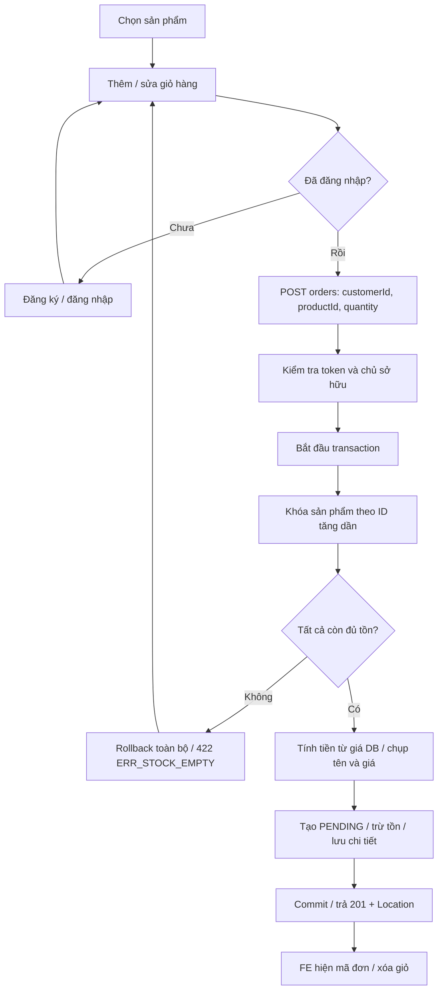
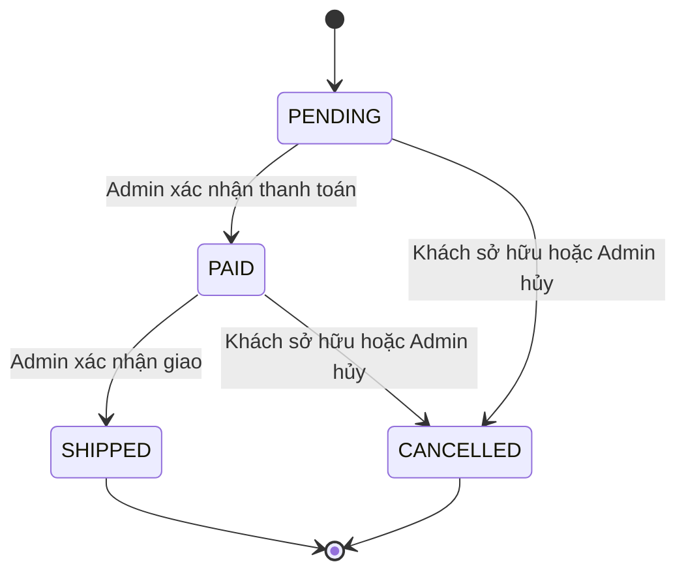
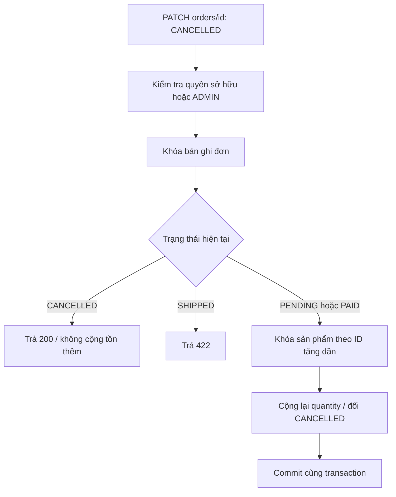
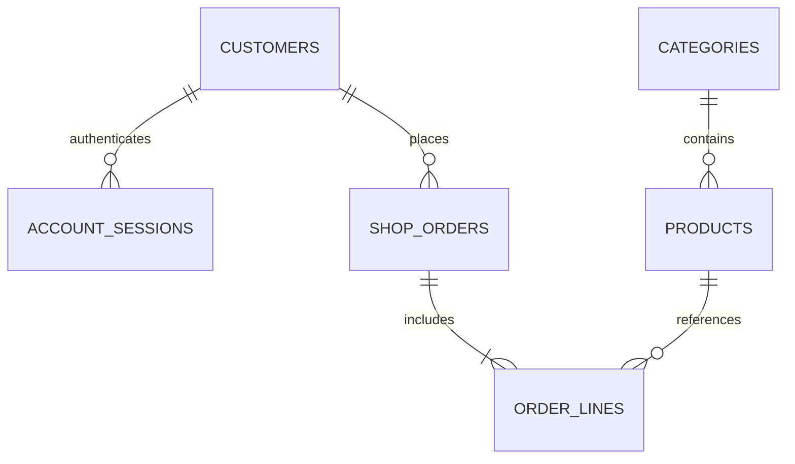

# Phân tích nghiệp vụ — NOVA Shop E-commerce

## 1. Phạm vi, vai trò và giả định

Khách chưa đăng nhập được xem danh mục, tìm/lọc/xem chi tiết sản phẩm và xây dựng giỏ hàng cục bộ. Khách có tài khoản được cập nhật hồ sơ, đặt hàng, xem và hủy đơn của mình. Quản trị viên quản lý danh mục, sản phẩm, tồn kho và trạng thái tất cả đơn.

Tiền tệ: VND; không tính phí vận chuyển/thuế/khuyến mãi. `PAID` là trạng thái do quản trị xác nhận trong bài thực hành, không tích hợp cổng thanh toán hay thu tiền thật. `SHIPPED` là trạng thái kết thúc theo đề mới. Đơn đã giao không được hủy. Khách có thể hủy PENDING hoặc PAID; đây là hoàn tồn kho, không phải giao dịch hoàn tiền bên ngoài.

## 2. User stories và acceptance criteria

| ID | Vai trò | User story | Điều kiện chấp nhận |
|---|---|---|---|
| US-01 | Khách | Tôi muốn đăng ký để lưu hồ sơ và mua hàng | Email hợp lệ/duy nhất; phone 9–15 chữ số, có thể bắt đầu +; mật khẩu 8–64 ký tự, tối đa 72 byte UTF-8; trả 201 và phiên đăng nhập |
| US-02 | Khách | Tôi muốn đăng nhập/đăng xuất | Email + BCrypt password hợp lệ cấp Bearer token 8 giờ; sai trả 401; logout thu hồi token |
| US-03 | Khách | Tôi muốn sửa hồ sơ | Chỉ sửa hồ sơ chính mình; email trùng trả 422; không được tự đặt role ADMIN |
| US-04 | Mọi người | Tôi muốn tìm sản phẩm phù hợp | Tìm theo tên không phân biệt hoa thường; lọc danh mục, giá từ/đến, sort giá và phân trang; minPrice > maxPrice trả 400 |
| US-05 | Mọi người | Tôi muốn xem sản phẩm trước khi mua | Chi tiết có tên, ảnh, mô tả, danh mục, giá và tồn kho; ID không có trả 404 |
| US-06 | Khách | Tôi muốn sửa giỏ hàng | Thêm, tăng, giảm, bỏ sản phẩm; tạm tính cập nhật ngay; giữ giỏ khi API lỗi; giỏ lưu localStorage |
| US-07 | Khách | Tôi muốn đặt hàng an toàn | Cần đăng nhập; customerId thuộc người gọi; items không rỗng/trùng sản phẩm; transaction khóa tồn, tính giá server, lưu PENDING và trừ tồn; trả 201 + Location |
| US-08 | Khách | Tôi muốn xem lịch sử | Phân trang đơn của mình, gồm mã đơn/trạng thái/giá chụp lúc mua; đọc đơn người khác trả 403 |
| US-09 | Khách | Tôi muốn hủy đơn | PENDING/PAID được CANCELLED và hoàn tồn một lần; gửi lặp không hoàn tồn thêm; SHIPPED trả 422 |
| US-10 | Admin | Tôi muốn quản lý danh mục | CRUD danh mục; không xóa danh mục có sản phẩm; khách thường gọi mutation trả 403 |
| US-11 | Admin | Tôi muốn quản lý hàng hóa | Tạo/sửa/xóa sản phẩm; ảnh SVG nội bộ hoặc HTTPS; giá dương có tối đa 2 số lẻ; sản phẩm có lịch sử không được xóa |
| US-12 | Admin | Tôi muốn điều chỉnh tồn kho | PATCH stock >= 0, khóa cùng bản ghi mà checkout sử dụng; không có lost update |
| US-13 | Admin | Tôi muốn xử lý đơn | Danh sách phân trang; PENDING -> PAID -> SHIPPED; được CANCELLED trước khi giao; chuyển sai trả 422 |
| US-14 | FE developer | Tôi muốn dùng mock trước backend | Cùng UI chuyển Base URL :4010/:8080/api/v1; ví dụ JSON khớp schema; 26 endpoint có Postman schema assertion |

## 3. Luồng đặt hàng

## 4. Luồng hủy và trạng thái

## 5. Business rules và dữ liệu

- Email chuẩn hóa trim + lowercase, kiểm tra trùng ở service và unique constraint database.
- Phone là chuỗi để giữ số 0 đầu. Không dùng kiểu số cho số điện thoại.
- Không tin giá/tổng tiền từ trình duyệt. Checkout chỉ nhận ID và quantity; BigDecimal tính tiền ở server.
- Lưu bản chụp productName/unitPrice/subtotal tại OrderLine để lịch sử không đổi theo giá hiện tại.
- Mọi dòng đặt được kiểm tra trong một transaction; một dòng thất bại rollback toàn bộ tồn và đơn.
- Khóa pessimistic theo ID tăng dần giảm deadlock giữa hai giỏ khác thứ tự.
- Khách không đọc/sửa hồ sơ hoặc đơn người khác. Chỉ ADMIN được xem toàn bộ danh sách khách/đơn và thay catalog.
- Giỏ hàng là trạng thái FE, không giữ chỗ tồn kho. Tồn được xác nhận lại khi checkout.
- Database seeding chạy khi khởi động, không nhân đôi dữ liệu; dữ liệu phiên bản cũ được bổ sung phone/category/ảnh, không xóa đơn.
- Token ngẫu nhiên 256-bit, database chỉ lưu SHA-256 token; mật khẩu lưu BCrypt; session bị xóa khi logout.

## 6. Mô hình dữ liệu

## 7. Phạm vi không triển khai

Không có thanh toán thật, giao vận, reset mật khẩu/email verification, đa cửa hàng hoặc upload ảnh. Admin chọn ảnh SVG nội bộ; API cũng nhận URL HTTPS. Các tài khoản mẫu chỉ phục vụ bài tập cục bộ. Đây là các giới hạn được xác định trong BA, không phải tính năng đã được kiểm chứng.
